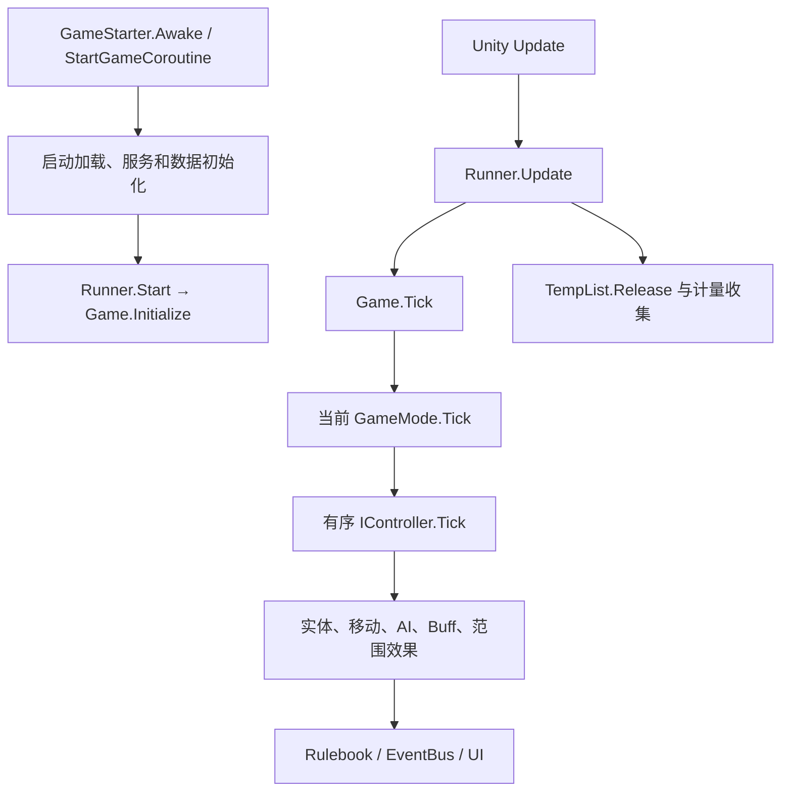

# 本机程序结构与首轮逆向结论

分析日期：2026-10-20（Asia/Hong_Kong）。本报告以本机 DLL、反编译结果、Version.info 和已有日志为证据。

## 已确认的安装基线

| 项目 | 结果 | 证据 |
|---|---|---|
| 游戏目录 | `D:\SteamLibrary\steamapps\common\Pathfinder Second Adventure` | 实际文件枚举 |
| 游戏版本 | `2.7.0x` / `2.7.0` | `Wrath_Data/StreamingAssets/Version.info`，构建时间字符串为 2025-Apr-02 |
| Unity | `2020.3.48f1 (b805b124c6b7)` | 当前 UnityPlayer.dll 的 ProductVersion |
| 脚本运行时 | Mono / 托管 .NET IL | `MonoBleedingEdge` 和可直接反编译的 Managed 程序集 |
| Mod 加载 | Doorstop → Unity Mod Manager | doorstop_config.ini 指向 `Wrath_Data\Managed\UnityModManager\UnityModManager.dll` |
| UMM 历史运行版本 | `0.32.4.0` | 2026-05-02 修改的 Log.txt；不是本轮运行探测 |
| 程序集 | Managed 树内 207 个 DLL 文件 | inventory.json，包括 UnityModManager 子目录 |
| 已安装 Mod | 51 个目录 | 目录与 Info.json 快照，不等于当前全部成功启用 |

`Assembly-CSharp` 仍使用 `Kingmaker.*` 命名空间，这是此安装的实际命名。firstpass 中出现平台 SDK，核心程序集也出现 `IL2CPP` 命名空间，均不能单凭名字判断该安装使用 IL2CPP；可读托管方法体和 Mono 目录才是本轮采用 Mono 分析路径的依据。

## 程序分层

| 层 | 文件/命名空间 | 职责和优化关系 |
|---|---|---|
| Unity 原生层 | Wrath.exe / UnityPlayer.dll / MonoBleedingEdge | 渲染、物理、Mono 执行；本轮未做原生函数逆向 |
| 游戏核心 | Assembly-CSharp.dll，10,150 个 C# 文件 | 实体、战斗、规则、AI、UI、场景、存档、Mod 接口 |
| 预编译依赖 | Assembly-CSharp-firstpass.dll，2,913 个文件 | 大量 Steamworks、Epic SDK、QuickGraph、UI 扩展；不宜将整层作为战斗优化入口 |
| Owlcat 公共层 | Owlcat.Runtime.Core.dll，209 个文件 | 临时集合、日志、对象工具、PBD/Jobs 等 |
| Owlcat 视觉层 | Owlcat.Runtime.Visual.dll，318 个文件 | 自定义 RenderPipeline、Pass、后处理、天气、战争迷雾 |
| 第三方系统 | AstarPathfindingProject、UniRx、Newtonsoft.Json、Unity.TextMeshPro 等 | 寻路、响应式 UI、序列化、文本 |
| Mod 层 | UMM、0Harmony、Mods 下各 DLL | 通过运行时补丁改变游戏；存在多份 Harmony 文件，需检查实际加载身份 |
| 数据层 | Bundles、Wrath_Data/StreamingAssets | 资源包、蓝图、语言、音频；蓝图运行加载走 `Bundles/blueprints-pack.bbp` |

完整程序集依赖与按文件数统计的命名空间见 `analysis/structure.json`。文件数不等于严格类型数，嵌套类型通常仍在同一文件内。

## 启动与主循环

源码入口，相对路径均基于 `analysis/decompiled/Assembly-CSharp/`：

- `Kingmaker/GameStarter.cs`：Awake、StartGameCoroutine 管理启动服务与加载。
- `Kingmaker/Runner.cs:83`：Update 驱动 `Game.Instance.Tick()`，之后调用 `TempList.Release()`。
- `Kingmaker/Game.cs:830`：Tick 区分加载状态，更新真实时间并调用当前游戏模式；加载中暂停部分逻辑。
- `Kingmaker.GameModes/GameMode.cs:32`：按数组顺序逐个执行控制器，捕获控制器异常；模式失活后停止继续执行。
- `Kingmaker.GameModes/GameModesFactory.cs:137`：Initialize 注册控制器及适用模式，共提取 124 条 Register 调用。

控制器顺序是游戏语义的一部分，例如时间、移动、视野/休眠、AI、命令、Buff、区域效果之间存在依赖。暂停、对话、全屏 UI、世界地图、战术战斗各有不同控制器集合；不能只在 Default 模式验证后就宣称优化通用。

## 实体、单位、Facts 和回合

主要对象是 `EntityDataBase`、`UnitEntityData`、`EntityFact`、`EntityFactsManager`，位于 `Kingmaker.EntitySystem*`。单位组合属性、Parts、Buffs、Commands、CombatState、Brain、View，而不是把全部行为写在单一 MonoBehaviour 中。

`BaseUnitController.Tick` 默认遍历 `Game.Instance.State.AwakeUnits`；`TickSleeping` 为真时遍历全部 Units。`SleepingUnitsController` 根据战斗、战争迷雾、命令、过场和计时器维护 AwakeUnits，因此屏外单位不能直接等价为可停止更新的单位。

尤其要注意 `UnitBuffsController` 明确覆写 `TickSleeping => true`，并让 `ShouldTickOnUnit` 始终返回 true。它还处理暂停 Buff 以及双生伙伴。盲目跳过休眠/死亡单位可能改变 Buff 到期和恢复行为。

`UnitTicksController` 在非回合制分支累计 GameDeltaTime，达到 6 秒后触发 TickNextRound；后者遍历 Facts 的临时快照并调用 ITickEachRound。回合制由另一套控制器协调，不能整体降低单位 Tick 频率。

## 事件和规则管线

`Kingmaker.PubSubSystem/EventBus.cs` 区分全局订阅和单位订阅，实际分发落在 `SubscriptionManager<TSubscriber>`。订阅接口通过 `InterfaceFinder<TSubscriber>` 按 Type 缓存；这一层已经有反射缓存。

分发时管理 Executing 计数、异常、代理订阅和上下文，在最后 Cleanup。优化此处必须保留嵌套事件、事件期间退订、监听器顺序和 ContextData 的生命周期。

`Kingmaker.RuleSystem/Rulebook.cs` 的 TriggerEvent 维护上下文栈，防止同一事件重复触发，并对深度超过 25 的规则链报错。内部顺序包括：

1. AssignSource；BeforeEvent 全局通知。
2. RulebookEventBus.OnEventAboutToTrigger。
3. 规则自身 OnTrigger。
4. AfterEvent 通知。
5. OnEventDidTrigger 与规则 OnDidTrigger。

装备、专长、Buff 的规则订阅和各种 Mod 都可能插在此链条。减少调用不能以丢弃任意订阅者为代价。

## AI、寻路、视野与范围效果

- `Kingmaker.AI/AiBrainController.cs`：按战斗单位组循环，进行动作和目标评分。非回合制通常受 `NextCommandTime` 限制，非 Free/Swift 指令设置约 0.3–0.4 秒延迟；并非每帧对每个单位完整重新决策。
- `Kingmaker.Controllers.Units/UnitMoveController.cs`：检查 AstarPath 与回合制 UI 状态，更新清醒单位移动并发布移动事件。
- `Kingmaker.View/UnitMovementAgent.cs`：PathTo、FindPath、TickMovement、UpdateAvoidance；通过 SeekerWithClearance 发出请求，Path 对象有 Claim/Release 生命周期。
- `Kingmaker.Controllers.Optimization/UnitVisionRangeController.cs`：对 AwakeUnits 做胶囊体空间查询，复用 512 项 Collider 缓冲，再填写 CanBeInVisionRange。
- `Kingmaker.Controllers/AreaEffectsController.cs`：使用 MixedTickProlongationEntityPool；施法者的战斗状态影响每帧或延后更新分组。
- `Kingmaker.Controllers.Optimization/TickProlongationEntityPool.cs`：链表分帧轮转，默认至少每帧 5 项、最大帧间隔参数默认 3。调用点可传不同参数，不代表所有系统采用相同频率。

这些是可量测的候选区域；静态遍历次数只能提示潜在成本，无法确定本机卡顿瓶颈。

## 蓝图、资源与存档

`BlueprintsCache.Init` 打开 `Bundles/blueprints-pack.bbp`，读取 GUID → 偏移的目录，并建立二进制反射反序列化器。`Load` 在锁内 Seek、读取蓝图、调用 `OwlcatModificationsManager.OnResourceLoaded` 接受替换、执行 OnEnable，再缓存对象。不是每次访问都重新解压根目录的 blueprints.zip。

因此不能只用一个并行字典替换锁：共享 FileStream 的位置、序列化器状态、Mod 替换回调和初始化顺序都必须保留。已加载蓝图亦可能由 Mod 增删或替换，额外缓存需要失效策略。

`Kingmaker.EntitySystem.Persistence/SaveManager.cs` 已存在 SaveRoutine、SerializeAndSaveThread、后台任务、截图等待和提交等待。序列化通过 Newtonsoft.Json 和自定义 Converter/DefaultJsonSettings；并非一个同步 Serialize 调用即可概括。

存档优化应分开测量实体快照、玩家/队伍/区域序列化、压缩、截图和提交等待。一次简单改成 Task.Run 并不能保证安全，也可能重复现有异步化。

## 已有优化基础和测量限制

`Owlcat.Runtime.Core.Utils/TempList.cs` 主线程上从池领取 List，Runner.Update 末尾集中 Clear 并归还；非主线程分支直接新建 List。`ToTempList` 仍有复制和池增长成本，但不能无条件视为每次必然产生托管 List 分配，也不能把所得列表长期缓存或跨帧持有。

`Kingmaker.Utility/ProfileScope.cs` 在零售/非 Development 条件下通常直接返回 null，且本版 Open 方法体为空。仅打开某个开关或看到源码有 ProfileScope，就推断能取得完整 Profiler 标记是不可靠的。需要独立的受控采样或经验证的外部分析链路。

本轮未启动或注入游戏，未读取存档内容，未采集帧时间、CPU/GPU 或实际 GC 数据，也未逆向渲染器原生实现。当前对托管主逻辑已经建立了可检索的结构图与入口，性能结论应由下一阶段运行测量验证。
