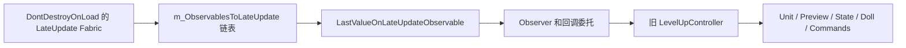

# 升级、切图、长期内存问题：深入逆向分析

更新于 2026-10-20。本轮完成 51 个已装 Mod 主程序集以及 8 个游戏/运行库程序集的源码准备，共 59 个输出目录、28,232 个 C# 文件；**源码已全部可检索，不代表逐行审计了全部文件**。重点调查 30 项机制，定位 65 处源码证据。

结论先行：最应优先验证的是 **LateUpdate 订阅根、升级预览及其外观设置/装备引用、贴图合图与压缩完成链**。它们有可能把“开界面慢”“切大城市慢”“玩久后恶化”连接起来，但目前没有同一次故障的运行追踪，不能认定已经找到了唯一根因。

## 证据如何分级

- **已确认行为**：从本机 DLL、配置或存档直接读到，能够指出具体位置。
- **库级实测**：独立进程调用本机 UniRx / Owlcat UI 的纯托管逻辑，验证生命周期语义；没有运行 Unity 原生层或启动游戏。
- **强静态风险**：能够给出长期根到对象的保留链，或明确缺失清理的路径；仍要确认游戏中的触发条件、已有补丁和实际代价。
- **条件风险/成本候选**：只有在请求失败、对象数量大或特定功能启用时才可能显著。
- **已降级/排除的推断**：看到相关代码或文件很大，不足以直接作为根因。

所有源码入口见 [证据索引](evidence-index.md)，机器可读结果见 `analysis/deep-audit-findings.json`。以下 R/U/L/M/C/F 编号与索引一致。

## 1. 最强的跨症状链：LateUpdate 和旧 UI 生命周期

### R01：升级控制器可被跨场景单例持有

`LevelUpController.UpdateCommand` 首次访问时，订阅 `UpdateCommandOnLateUpdate.ObserveLastValueOnLateUpdate()`，回调调用该控制器的 TryUpdateDoll 和 m_UpdateCommand.Execute。返回的 IDisposable 未保存。

追踪到的根链如下：



Fabric 每帧遍历其链表；Observable 在订阅句柄 Dispose 且观察者数归零时才移除节点。控制器 Commit/Stop 处理了 Preview.Dispose、回调及 Game.LevelUpController 清空，但未见这条订阅的释放或两个 ReactiveCommand 的 Dispose。

**解释能力**：即使旧预览已 Dispose，它的托管对象仍可能被字段引用；旧节点也会继续参与 LateUpdate 遍历。需要 getter 曾被访问才有此链，不能把所有自动升级控制器都计入泄漏。

**验证**：连续打开/关闭升级，计数 Fabric 节点和其中关联的已 Stopped 控制器；对控制器用弱引用追踪，确认 UI 完成并经历正常 GC 后仍被此根持有。本轮静态检索未找到针对该完整链的明确修复，但实际 Harmony 补丁顺序仍需运行确认。

### R03：上游完成不保证该 LateUpdate 包装器退出单例链

本机 `LastValueOnLateUpdateObserver.OnCompleted` 只向下游转发完成，OnError 同样只转发，没有调用继承自 OperatorObserverBase 的 Dispose。取消逻辑才会触发 Observable 的 CompositeDisposable，并最终从 Fabric 移除节点。

已直接实例化本机程序集里的这个观察者，在独立进程验证：**OnCompleted 确实转发了完成，但取消句柄未被 Dispose；显式 Dispose 才执行取消**。因此不能用“上游 UI 已 Dispose / Subject 已完成”代替对此包装器清理的验证。

这是库语义证据，不是本轮记录到游戏泄漏的现场快照。未来修复优先绑定明确的 UI/控制器关闭生命周期；全局修改泛型操作符还需测试嵌套、重入、完成/异常和取消行为。

### R02：只释放末端订阅，可能留下中间 ReactiveProperty

`GetReactiveProperty` 每次创建一个 ReadOnlyReactiveProperty，构造时立即订阅控制器的 UpdateCommand。多处调用形如：

```csharp
AddDisposable(controller.GetReactiveProperty(...).Subscribe(...));
```

AddDisposable 得到的是末端订阅，不是中间属性对象。独立测试确认，释放末端订阅后，下一次 UpdateCommand 仍执行 propertyGetter；只有 Dispose 中间 ReadOnlyReactiveProperty 才断开上游。

**条件**：要导致跨界面保留，源或源的拥有者还必须长期存活；纯内部循环引用本身不阻止 GC。R01 的根可以放大 R02；一些 getter 还闭包捕获 VM，另一些只捕获控制器，不能一概而论。

### M03/M04：相同模式也出现在别的 UI

- ToyBox EnhancedSpellbookController.Setup 对 RefreshCommand 使用未保存的 LateUpdate 订阅，并对 CurrentSpellbookLevel、MetamagicBuilderMode 等增加订阅；OnDestroy 仅释放 m_SelectedUnitUpdate。OnEnable 清空 m_spellbook 后，Update 会重新 Setup，需要验证同一组件反复启用时的订阅增长。
- 保存的 ToyBox Settings.xml 中 `toggleEnhancedSpellbook=true`。这让该候选比关闭的多职业功能更贴近当前配置，但不是运行命中证明。
- 两个战术战斗先攻视图的 BindViewImplementation 也出现未保存的 LateUpdate 订阅。需要验证究竟实例化/反复绑定哪一个，不能把两个类型都当作每次必定运行。
- ToyBox 虽有 `EventBus.Subscribe(this)`，该类声明只含 IGlobalSubscriber/ISubscriber 标记，不能单凭这行就认定 EventBus 一定建立了有效监听根；优先证据是 LateUpdate 包装链和具体绑定源。

## 2. 升级和打开角色面板的同步成本

### U01：预览复制与动作重放

需要重算时，UpdatePreview 分离或重建 View，Dispose 旧 Preview，创建新副本，再重放 LevelUpActions。CopyInternal 复制 progression、stats、facts、spellbooks、proficiencies、items，可能建 View/装备/纸娃娃并 TurnOn。每项都会经过现有 Mod 回调。

可优化方向是减少同一次用户操作的冗余重算、复用经过验证的纯数据结果。不能只缓存一个旧预览复用：撤销、职业/神话切换、伙伴/宠物、装备、先决条件、规则订阅和随机状态都影响正确性。

### U02：进展界面构造存在重复初始刷新模式

CharInfoComponentVM 的构造器订阅 Unit；UnitProgressionVM 随后又订阅带初始值的 m_JustGotClass。UniRx ReactiveProperty 会立即向新订阅者发送当前值。当 Unit 非空时，这可在构造流程中触发两次进展刷新；随后 SetJustGotClass 还可能触发新的刷新。

使用本机 UniRx/UI 库复现了这一构造模式的双发射。还没有计时游戏中完整进展树，因此它是“确实可能重复构建”的机制证据，不是几十秒卡顿已归因于它的证明。

### U03：列表注册成本会随候选数量呈二次增长

BaseDisposable.AddDisposable 用 List.Contains 去重；选择器为所有候选专长构造 VM，并逐个 AddDisposable。单纯注册 N 个不同对象的查重工作量为 N(N−1)/2。

本机实际 BaseDisposable 测试：加入 1,000 个不同 IDisposable，执行 **499,500 次 Equals 检查**。这不是耗时基准，Equals 次数也不等于等量昂贵操作，但说明大量扩展专长会放大这层基础成本。不能盲目替换整个 UI 框架的容器：必须保留相等性语义、去重、拥有者关系和逆序释放。

### U04：推荐标记反复分配并保留到父级释放

CharGenFeatureSelectorItemVM.UpdateRecommendation 每次 new RecommendationMarkerVM、覆盖当前属性并 AddDisposable，没有在此处释放旧标记。对应 PC View 只重新 Bind，新旧 View 的切换不等于释放旧 VM。

因此同一选择器活跃期间多次刷新可以积累旧推荐标记及其 ReactiveProperty；它们最终可随父级 Dispose 清理，不能直接称为永久泄漏。与 U03 合在一起，积累还可能提高后续 AddDisposable 的查重成本。可调查“推荐值没变时不替换”和“替换时显式释放旧值”。

### U05：资格判断、嵌套选择和描述/图标初始化

建立每个专长 VM 会取 Icon、Name、Description、FeatureTags 并进行选择状态和推荐更新。CanSelect 使用 AllFeatures.Contains、MeetsPrerequisites 和嵌套可选性遍历；CanSelectAny 又用 Any 递归到各候选。UI 刷新可能对全部项目重复做这些工作。

候选方向包括同一预览版本下的资格查询缓存、先显示可见项目、延迟昂贵描述/图标求值。要区分 UI 虚拟化和数据 VM 创建：只虚拟化可见控件，不一定减少全部候选的资格计算。嵌套选择是否成环需实际蓝图图结构验证，不能因为旧 Isekai 启动警告就认定 UI 在无限递归。

### U06：已有角色面板也会建立纸娃娃

DollRoom 创建或克隆 Character、复制装备/模型、更新渲染器及动画管理器，所以普通角色面板与建卡可能共用头像/外观/合图成本。它与升级预览复制不是同一件事。

Cleanup 中已看到 Destroy Avatar、移除 OnUpdated、释放 Hands/Fx 和清 DollState 回调，不能声称整个纸娃娃完全没有清理。重点看是否重复创建、是否被 Mod 加重，以及贴图压缩/外观资源是否在下层仍被保留。

## 3. 眷泽城数分钟加载的可能路径

### L01/L02：合图、GPU 回读、DXT 工作任务

Game.AwaitTextureCompression 每帧更新 AtlasService，并等待 Atlas 请求数、DXT 请求数、Character.WaitCalculatedCount 全归零。该等待循环未见总超时。不能把它当成磁盘加载阶段。

DXTCompressor.dll 中看到：

1. 每个 mip 发 AsyncGPUReadback。
2. 成功回读复制到 Allocator.Persistent 的 NativeArray，先存入 SourceBytes。
3. 收齐后创建后台 Task 压缩；正常末尾 Dispose 每个输入数组并设 m_IsComplete=true。
4. 服务 Update 在 IsComplete 后调用回调、移除请求并 Clear。

**条件性缺口一**：后台任务体未见 try/finally、catch 或保留 Task 供错误检查；若压缩中途抛异常，完成标志可能不设置、剩余 NativeArray 也不释放，加载等待无法知道该任务已经失败。

**条件性缺口二**：一个 mip 回读失败时先设 HasError；若此前别的 mip 已分配 Persistent 数组，后续 Clear 只清 TextureIn/Out 和 OnDone，没有遍历 SourceBytes 释放。存在错误路径下原生分配遗留的风险。

**条件性缺口三**：服务在 Remove 之前执行完成回调；若回调抛出异常，可能跳过移除。CharacterAtlas 的回调有自己的 finally 清理 RenderTexture，但不等于清理了 DXT 的 SourceBytes，也不保证服务队列最终完成。

以上均未在本机游戏故障现场复现。旧四份日志没有搜到 AsyncGPUReadback failed 或 Failed to compress atlas to DXT，因此不能说“你的机器已经触发这个错误”。不过该链同时涉及等待和原生内存，应列为高优先级诊断目标。

修复时需先解决异步所有权：不能给等待加超时后直接释放仍被 GPU/工作线程使用的数组，否则会制造访问已释放内存的问题。需要任务完成/失败状态、回读完成屏障、一次性回调和安全清理协议。

### L03：光照和反射探针

SceneLoader 的光照匹配会等待 IsProbeBaking，局部 timeout 为 60 秒；仅在相关光照场景/设置下执行。大型城市可能增加反射探针和激活工作，但还需记录实际光照场景与探针状态。旧日志未见超时错误；该单段约一分钟的上限也不能独自解释所有数分钟等待。

### L04：区域 JSON、实体恢复及 Mod 回调

区域恢复经过 Unstash、PrePostLoad、PostLoad、Inventory.PostLoad、ApplyPostLoadFixes、TurnOn 和 View 附着。它们涉及所有活跃场景的实体和物品，复杂 Buff/Facts 与 Mod 回调可能比 JSON 字节读取更贵。

LoadSceneEntities 已建立 UniqueId → View 字典，**不是简单把所有实体与所有 View 双重遍历**。这里仍有对象创建和多阶段遍历，但不能以“换成字典”为未经验证的优化建议。

### L05：自动存档与等待提交

切图可能先等待旧存档提交，加载前/后也可能自动存档；SaveRoutine 还等待当前读写状态、截图任务，并进行序列化/压缩/提交。VisualAdjustments2 又在保存 header 时序列化所有外观设置。

因此应分开记录“区域离开前等待”“加载主段”“自动存档”“完成前回调”。不能只给 SceneLoader.LoadAreaCoroutine 计时，随后得出“加载总共只需几秒”。

### L06：资源清理和 GC

UnloadUnusedAssetsCoroutine 已执行资源缓存清理、头像清理、音频回调清理、GC.Collect 和 Resources.UnloadUnusedAssets 的异步等待。长期积累的根或原生资源可能使此阶段越来越重。

ResourcesLibrary 的默认清理还区分 RequestCounter、HandleCounter、预载模式与池资源。部分记录在本轮清理只将 RequestCounter 清零，后续清理才满足卸载条件。不能只看第一次残留就认为计数器完全错误，也不能在仍有 Handle 时强制卸载。

### L07：FX 池高水位

FX 池有 LRU 类型容量限制、切图清理和队伍相关资源保留机制，不能称为无限增长的无上限字典。每一池的队列仍可能保留某次战斗的峰值实例，且有池实例时资源库会跳过卸载；需区分预期缓存高水位和真正持续增长。

### L08/M05：头像磁盘 I/O 与原生贴图

预载阶段逐单位访问 Portrait/OverridePortrait；同步 SpriteLoadingRequest 会 ReadAllBytes、LoadImage、Sprite.Create。CustomNpcPortraits 的部分 getter 中有路径枚举、文件存在检查、创建目录、Storage.Unload 和 new PortraitData，可能放大高频头像访问。

ResourceStorage.Unload 只移除请求字典条目，并不直接 Destroy Sprite/Texture。CustomPortraitHandle 还可能保留旧 Request；只移除字典项既不能证明立即释放，也不能证明永远不释放。需要查看是否仍有句柄、贴图数量和反复重载；不能把自定义头像预先全部永久缓存作为默认解法。

## 4. VisualAdjustments2 的持久化和内存保留

### M01：设置新增不区分已有/临时单位

GlobalCharacterSettings.ForCharacter 按 UniqueId 不命中就创建 CharacterSettings 并加入静态 PerCharacter。GetVisualSettingsProvider 补丁仅检查玩家阵营就访问 GetSettings，未见预览过滤；AddItemEquipment 和特效补丁也有类似入口。

在本轮反编译的这个主程序集内，没有找到 PerCharacter.Remove/Clear；LoadGame 时会用存档数据替换整个 Instance。SaveHooker 保存 header 时把全表序列化。

这构成“临时/历史单位被查询过 → 设置长期留表 → 随存档继续保存”的候选链。还需要实测升级预览是否在每次重建中命中这些入口，不能仅凭旧 ID 不存在就判定全是预览。

### M02：CurrentFXs 清列表不删 ItemEntity 键

CharacterSettings.CurrentFXs 为 `Dictionary<ItemEntity,List<IFxHandle>>`，即使用装备对象作强引用键。对应武器特效补丁清理旧 FX 后只 Clear 值列表，没有 Remove 键；随后按当前装备建立新键，即使当前覆盖列表为空也可能建条目。

如果外层 CharacterSettings 长期保留，换装备或复制预览可能留下旧 ItemEntity 引用。是否进一步持有整套旧单位，要检查物品 HoldingSlot、Collection、Wielder 和附魔上下文在 Dispose 后的实际对象图，不能直接将整条单位图的大小归到此键上。

### M06：颜色/眼睛贴图缓存

ColorToTex 与 loadedSprites 是静态字典，当前代码路径未见统一回收。每个唯一颜色或图片 ID 会新增贴图/Sprite；风险与用户实际外观操作有关。1×1 色带贴图的单项成本较小，不能优先把它当成数 GB 内存根因。

## 5. 本机数据给出的支持与限制

### 存档：49 个文件，只读检查

读取 ZIP 元数据，进一步解析最近三个存档的部分 JSON；没有写回、清理或重新压缩任何存档。细节见 `analysis/save-structure.json`。

| 样本 | ZIP 大小 | 解压数据总量 | history | 眷泽城相关条目合计 |
|---|---:|---:|---:|---:|
| Manual_2823_1（最新修改） | 8.07 MiB | 49.38 MiB | 16.01 MiB | 4.24 MiB |
| Quick_159（另一个战役指纹） | 17.60 MiB | 109.70 MiB | 33.24 MiB | 7.38 MiB |
| Quick_77（与最新同一战役指纹） | 8.00 MiB | 49.15 MiB | 15.98 MiB | 4.24 MiB |

这些数字说明复杂区域和历史数据值得分项测量，但不能从几十 MB 文件直接推导出几分钟等待。history 使用文件追加流；文件大不等于整份一直保留在托管堆。不同战役不能作为连续增长曲线比较。

最新存档 VisualAdjustments2 数据为 **2,465,909 字节、2,353 条设置**；同战役 Quick_77 为 2,451,005 字节、2,330 条设置。最新设置 ID 有 579 个在其他 JSON 文本中出现、1,774 个未出现；其中与可识别的 UnitEntityData 定义 ID 对应的为 24 个。文本出现不等于活跃单位，不出现也不等于可安全删除。

眷泽城原始参考 BlueprintArea 含 15 个 Part 引用，动态/静态/光照分场景。存档里还有多个机制状态和迷雾条目。**Part 数不等于本次同时加载的场景数**，实际激活由剧情与当前 AreaPart 决定。

### 历史日志：已追到重复文本的具体来源

- `I told kuru this would happen` 来自 WrathPatches 的 UMM 类型注册到 GUID binder 时的重复 TypeId 检查。两份完整日志分别 644/1,188 次。属于启动绑定线索，不能自动解释玩了几小时后的每帧卡顿。
- Isekai 的 Level 10 防循环日志两次各 154 条，来源是蓝图进展树修改函数；代码本身有深度保护及 loopPrevention 数据，不能直接声称运行中存在无限递归。
- 未搜到本次关注的 DXT 失败、光照烘焙超时或明确 OOM 标记。只有“重复订阅”少量提示，无法把特定保留链和故障时间对应起来。
- DarkCodex 的 Prebuild 导出补丁包含每次升级动作 JSON 导出和同步追加日志，但带 WIP/Hidden/default false 标记，加载代码没有发现对应的常规 PatchSafe 注册，当前 Whitelist 也未列出。把它从主要嫌疑降级，除非运行清单证明已激活。

详见 `analysis/focused-log-markers.json` 和 `analysis/mod-relevant-config.json`。保存的开关只提供触发条件线索，不等于补丁成功加载的证明。

### 硬件：不能用“机械盘/没开分页文件”概括

本轮静态调查时系统可见物理内存约 32 GB，D 盘映射到 NVMe；C 盘存在约 27 GiB 已分配分页文件。说明简单的“没开虚拟内存”推断不适用。

这不是故障当时的提交量/硬缺页/磁盘延迟/GPU 显存记录，不能因此排除内存压力或 I/O 等待。没有改变分页文件、图形设置、杀毒软件或驱动。快照见 `analysis/hardware-snapshot.json`。

## 6. 明确排除或降低的推断

| 推断 | 本轮结论 |
|---|---|
| 所有 AddDisposable 的对象 Dispose 后仍永远留在父列表 | F01：错误；实际 BaseDisposable 会从 Owner 移除，已实测 |
| 单位 Dispose 完全不清事件或实体注册 | F02：错误；UnitEntityData/EntityDataBase 有对应清理。外部根持有 disposed 对象是另一问题 |
| 每次刷新必定重新建整份专长列表 | F03：不准确；阶段有首次创建保护，资格/推荐刷新仍可能反复执行 |
| PC 的 UnitAtlasService LOD 等待就是主因 | F04：当前实现对 PC 关闭该 LOD 服务分支；不能与 CharacterAtlasService/DXT 混为一谈 |
| FX 池所有条目都无限增加且从不清理 | L07：有 LRU 和切图清理，需测高水位/队伍保留 |
| 把 SceneLoader 的实体匹配换为字典就会大幅加速 | L04：已有字典，瓶颈应另测 |
| 旧日志几分钟没有输出就代表几分钟卡死 | 不成立，可能只是停留界面或暂停 |
| 托管 GC 能解决 Persistent NativeArray 或 GPU 资源泄漏 | 不成立，生命周期与所有权不同 |
| 没有 OOM 日志就绝对不是内存相关闪退 | 不成立；原生分配/显存/驱动/提交量问题可能没有该字符串 |

## 7. 实施顺序和可证伪条件

| 顺序 | 要验证的机制 | 下一次最关键指标 | 什么证据会让它降级 |
|---|---|---|---|
| P0 | R01/R03 的持久 LateUpdate 根 | Fabric 节点、旧 Stopped 控制器、绑定对象类型、关闭前后差值 | 节点正确回到基线，旧对象不再可达 |
| P0 | L01/L02 合图完成与错误清理 | Atlas/DXT 队列、请求年龄、mip 回读数、任务完成/失败、Persistent 数组字节 | 慢加载时此队列早已归零且无资源积累 |
| P1 | M01/M02 的设置/装备强引用 | 预览建立/关闭时 PerCharacter、CurrentFXs 键数变化及对应原对象 | 创建预览不增表，旧键及时消失或只保留有限必要数据 |
| P1 | U01–U05 同步重建成本 | 每次操作重建次数、候选数、资格检查/推荐标记数、耗时 | 方法耗时很小，卡顿实际发生在模型/合图或其他补丁 |
| P1 | L04/L05 区域恢复/存档 | 各阶段墙钟与同步时间、实体/Facts/物品数量、提交/截图等待 | 阶段均短且等待在其他部分 |
| P2 | M03/M04 其他 UI 累积 | 增强法术书/先攻视图重复绑定后的订阅与存活组件数 | 功能没触发或计数在关闭后恢复 |
| P2 | L03/L06/L07/L08 | 烘焙状态、清理时间、池实例、PNG 解码/资源命中 | 对应阶段与故障时间无关，计数稳定 |

0.1.0 只提供基础阶段和内存趋势。现已构建 **0.2.0**，补充 Fabric 节点与受限订阅链、控制器/预览弱引用、Atlas/DXT 队列及工作事件、原生数组描述符字节、VA2 设置/装备键和预览 ID 关联。说明及限制见 [诊断版使用说明](diagnostic-mod.md)。这些观测并不是完整保留根或原生分配审计，也尚无游戏内测量结果。

库中虽附带 UnityHeapCrawler，可指定根进行遍历，但完整快照可能触发 GC 和大量 Unity 对象扫描。此轮没有运行它；若后续使用，应先限定目标根和采集预算，不把它当作无开销的常驻记录器。

原生 UnityPlayer、GPU 驱动、显存峰值、系统提交失败、原生堆碎片、第三方覆盖层/杀毒扫描仍属于未实测范围。只有实际故障的队列状态、CPU 栈、系统资源记录或崩溃转储才能继续区分这些条件。

## 8. 本轮交付与验证

- 51 个主 Mod 反编译清单：`analysis/mod-decompilation-manifest.json`，无失败项。部分 Mod 另带依赖 DLL；未声称所有依赖、全部原生代码均已审计。
- 30 项机制及 65 处定位：`analysis/deep-audit-findings.json`、[源码证据索引](evidence-index.md)。每处保存文件哈希与行号，便于版本变化后复核。
- 只读存档结构及战役区分：`analysis/save-structure.json`；复现脚本 `scripts/analyze_save_structure.py`。
- 配置/硬件/日志聚合：analysis 下相应 JSON；源码索引与聚合脚本 `scripts/build_deep_audit.py`。
- 独立语义检查：`tests/ReverseSemantics`，**8 项通过、编译零警告零错误**。验证实际库的取消/订阅、父子释放、N² 查重和构造发射；不包含游戏内性能、GPU 异常或闪退复现。

诊断包已更新为 0.2.0，31 项独立诊断检查通过，尚未安装进游戏。没有部署优化补丁或修改游戏、Mod 配置、存档。用户补充无 Mod 原版也卡，应优先验证游戏本体机制，另测 Mod 的放大程度。发现的风险均需按上表证伪，再决定补丁范围。
